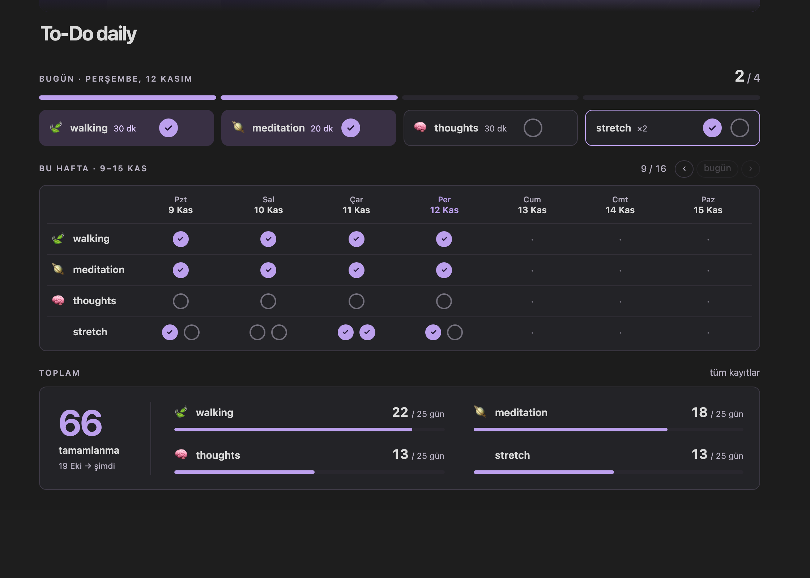

# To-Do daily

A one-page daily habit dashboard for Obsidian. Every day's habits are plain notes, a Templater script builds the panel, Meta Bind toggles are restyled as round check buttons, and Bases views add a calendar and heatmaps.



*The preview uses made-up sample data. The interface text is Turkish.*

## What you get

- **Today panel:** a progress bar and one round check button per habit (stretch has two). Rings fill instantly and the counts follow a second later.
- **Weekly grid:** shows the current week by default; **‹ bugün ›** pages through earlier weeks. Tick any past day. A dashed cell means "no note yet": one click starts that day.
- **Totals card:** completions per habit, "/ N days" ratio and a thin bar, plus a grand total.
- **One definition of "done"** for the day, week, month and year rates and for the heatmaps.
- **Self-maintaining:** today's notes are created whenever the dashboard opens and at midnight; the panel refreshes when a task changes; editing `todo.js` reloads it in the open session.
- **Views:** a calendar (Just Simple Calendar) and per-habit heatmaps (Life Tracker), both through Bases.

Default habits, all editable: walking 30 min 🍃, meditation 20 min 🪐, thoughts 30 min 🧠 and stretch ×2. No task history is included; the `Tasks/` folder starts empty.

## Requirements

- Obsidian 1.9 or newer (Bases core plugin). Built and tested on 1.15 on macOS.
- Core plugin **Bases** turned on.
- Community plugins: **Templater** (2.27), **Meta Bind** (1.5), **Just Simple Calendar** (1.6) and **Life Tracker** (3.6). Versions are the ones it was built with.

## Install

1. Install and enable the four community plugins and turn on the Bases core plugin.
2. Copy `vault/To-Do daily/` into the root of your vault and `vault/.obsidian/snippets/todo-daily.css` into `.obsidian/snippets/`. Enable the snippet: Settings → Appearance → CSS snippets → `todo-daily`.
3. Templater settings (values are in `setup/templater-settings.json`): set *Template folder location* to `To-Do daily/_templates`, *Script files folder location* to `To-Do daily/_scripts`, add `To-Do daily/_templates/generate-days.md` as a startup template, and turn on *Enable startup templates* (a per-device switch that Obsidian does not sync).
4. Meta Bind: add the two button templates from `setup/meta-bind-button-templates.json` (Settings → Meta Bind → Button templates). Alternatively, with Obsidian closed, put that array into `buttonTemplates` in `.obsidian/plugins/obsidian-meta-bind-plugin/data.json`.
5. Recommended: merge `setup/property-types.json` into `.obsidian/types.json` so the properties show up as checkboxes, dates and numbers.
6. Restart Obsidian and open `To-Do daily/@to-Do daily`. Today's notes and the panel appear by themselves.

A fresh vault works the same way; just do the steps above in it. The first run fills the blank start dates in `Ayarlar.md` with that day.

## How it works

- Each habit-day is a note in `To-Do daily/Tasks/`, named `YYYY-MM-DD <habit>` with properties such as `due`, `done`, `stretch_1`, `stretch_2` and `habit`.
- `_scripts/todo.js` (a Templater user script) creates the missing notes, computes the stats and writes `Sayaçlar.md`, the generated panel that the dashboard embeds.
- The round buttons are Meta Bind toggles bound to those properties; `todo-daily.css` draws them as rings. Ticking one edits the note directly.
- A small listener, installed by the startup template, refreshes the panel after task changes, handles the ‹ › arrows and the dashed cells, and prepares today at midnight.

## Customize

Details are in the vault's `Hakkında` note (Turkish). In short: change labels and durations in `TILES` and `GRID` at the top of `todo.js`, note names in `HABITS`, colors in the `--td-*` variables of the CSS, and dates in `Ayarlar`. To add a habit, add a line to `HABITS`, `CORE`, `TILES` and `GRID`; `tests/smoke.js` covers that case.

## Troubleshooting

- **The panel still says "hazırlanıyor":** open `Hakkında` → Bakım and press *↻ Sayaçları yenile* once (needs the Meta Bind templates), or run the `refresh-stats` template from Templater.
- **Check buttons look like ordinary toggles:** enable the CSS snippet and open the dashboard in Reading view.
- **‹ ›, dashed cells or auto refresh do nothing:** the listener is only installed once Templater has run a startup template in this session. Enable *Enable startup templates* or press the maintenance button.
- **`BUTTON[...]` shows an error:** the Meta Bind button templates are missing (step 4).
- **Calendar or heatmaps are empty:** Just Simple Calendar or Life Tracker is not installed.

## Tests

`node tests/smoke.js` runs the real script against a small in-memory fake of Obsidian's vault API (Node 18 or newer; no Obsidian needed). It checks the stats rules, first-run setup, toggles, week navigation, clicks, the midnight rollover and adding a habit. It does not replace trying the template in Obsidian.

## Layout

```
to-do-daily/
├── vault/                       copy into your vault
│   ├── To-Do daily/             dashboard, guide, settings, views, script, templates
│   └── .obsidian/snippets/      todo-daily.css
├── setup/                       plugin settings to apply by hand (JSON)
├── tests/smoke.js
└── docs/preview.png
```

## Türkçe özet

Günlük alışkanlık panosu: bugünün yuvarlak onay düğmeleri, sayfalayabildiğin haftalık ızgara, toplam kartı. Kurulum için yukarıdaki altı adımı izle: eklentiler (Templater, Meta Bind, Just Simple Calendar, Life Tracker), `vault/` içindekileri kopyala, Templater ve Meta Bind ayarlarını `setup/` dosyalarından gir. Arayüz Türkçedir; ayrıntılar vault içindeki `Hakkında` notundadır.
